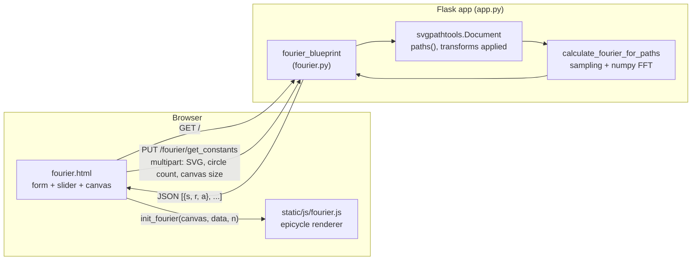
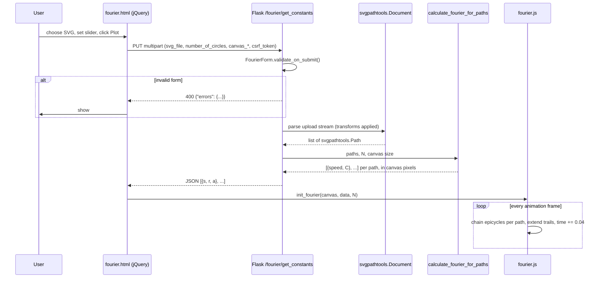

# Architecture

FourierDrawings is a small Flask web app that takes an uploaded **SVG**, splits it into its
individual paths, computes a **complex Fourier series** for each path on the server, and
animates the result in the browser as chains of rotating vectors ("epicycles") that redraw
every path of the image at the same time.

## Repository layout

| Path | Role |
| --- | --- |
| `app.py` | Flask application factory + dev-server entry point (port `$PORT`, default **8002**). |
| `fourier.py` | Flask blueprint: routes, upload form, SVG → Fourier coefficient computation. Also a small CLI. |
| `templates/base.html` | Base Jinja template extending Flask-Bootstrap's `bootstrap/base.html`; adds `main.css`. |
| `templates/fourier.html` | The single UI page: upload form, circle-count slider, error banner, canvas, and the jQuery AJAX glue. |
| `static/js/fourier.js` | Canvas renderer: builds epicycles from coefficients and animates them with `requestAnimationFrame`. |
| `static/css/main.css` | Styling for the slider / labels. |
| `examples/` | Source raster images, `kiwi.svg`, and a demo GIF (`SOURCES.txt` lists attribution). |
| `examples_svg/` | Ready-made SVG inputs to try in the app (mostly potrace output). |
| `outputs/` | Screenshots of rendered results (used by `README.md`). |
| `requirements.txt` | Python dependencies: Flask, Flask-WTF, Flask-Bootstrap, numpy, svgpathtools (≥ 1.6), gunicorn. |

## High-level design



The server is **stateless**: nothing is written to disk or kept between requests. All heavy
math is done server-side once per upload; the browser only evaluates rotating vectors per frame.

The app is **self-contained at runtime**: every page asset (Bootstrap, jQuery, fonts, the app's
own CSS/JS) is served by the app itself, and nothing calls out to third-party services. Network
access is only needed once, for `pip install`.

## Components

### Application bootstrap: [app.py](app.py)

- [`create_app()`](app.py#L11-L26) creates the `Flask` instance, initialises `Flask-Bootstrap`
  with `BOOTSTRAP_SERVE_LOCAL` (Bootstrap 3.3.7 and jQuery 1.12.4 are served from the copies
  bundled in the package, under `/static/bootstrap/`, not from a CDN), reads `SECRET_KEY`
  (needed for Flask-WTF CSRF tokens) from the environment, and registers `fourier_blueprint`. If `SECRET_KEY` is unset it logs a warning and uses a random per-process
  key. That is fine for one process, but every worker of a multi-worker server needs the same key.
- A module-level `app = create_app()` makes it usable by a WSGI server (e.g. `gunicorn app:app`).
- When run directly, it starts the Werkzeug dev server on `localhost:$PORT` (default 8002) with
  `debug=True`, passing every file under `templates/` and `static/` as `extra_files` so the
  reloader restarts on front-end edits.

### Blueprint & form: [fourier.py](fourier.py)

- [`FourierForm`](fourier.py#L23-L34) (Flask-WTF): `svg_file` (required, `.svg` only),
  `canvas_width` / `canvas_height` (required, 1…10000), `number_of_circles` (required,
  1…`MAX_CIRCLES` = 1000), `submit`.
- Routes:

  | Method | Path | Handler | Purpose |
  | --- | --- | --- | --- |
  | `GET` | `/` | [`fourier_index`](fourier.py#L37-L39) | Render `fourier.html` with an empty form (and CSRF token). |
  | `PUT`, `POST` | `/fourier/get_constants` | [`get_fourier_constants_post`](fourier.py#L42-L62) | Validate the upload, parse it, compute coefficients, return JSON. Errors return **400** `{"errors": {field: [messages]}}`. |

### SVG parsing: `svgpathtools.Document`

The upload stream is passed straight to
[`svgpathtools.Document(...).paths()`](fourier.py#L48-L54). It reads `<path>`, `<line>`,
`<polyline>`, `<polygon>`, `<rect>`, `<circle>` and `<ellipse>` elements, and applies their
`transform=` attributes and those of enclosing `<g>` groups. Each result is a `Path`, a
parametric curve `z(t)` with points represented as complex numbers `x + iy` in the SVG's user
coordinates (y pointing down, like the canvas). Any parse failure becomes a 400 response.
Elements outside `<g>` nesting (e.g. inside `<defs>`, `<a>`, `<use>`) are not read.

### Fourier computation: [fourier.py](fourier.py#L81-L146)

For `N = number_of_circles`, each path contributes `2N − 1` coefficients of

```
c_n = ∫₀¹ z(t) · e^(−2πi·n·t) dt
```

1. **Filtering.** Paths with no segments or zero length are dropped. If nothing is left, the
   request fails with "This SVG contains nothing to draw."
2. **Sampling.** [`sample_path`](fourier.py#L81-L99) evaluates each path at
   `M = max(1024, 8N)` evenly spaced values of `t`, one numpy call per segment. Each segment
   gets a whole number of samples in proportion to its length. Where the path jumps (between
   subpaths, or from its end back to its start), the sample on the jump is the midpoint of both
   sides, so the trapezoidal rule stays accurate across jumps.
3. **Coefficients.** `np.fft.fft(samples) / M` yields every `c_n` at once; the ones for
   `n = 0, 1, −1, …, N−1, −(N−1)` are kept.
4. **Layout.** [`fit_to_canvas`](fourier.py#L102-L116) takes the bounding box of all samples
   of all paths and returns one `scale` and `offset` that fit it, centred, into the client's
   canvas with a 20 px margin (`CANVAS_MARGIN`). Because the mapping `z ↦ z·scale + offset`
   is affine, it is applied to the coefficients directly: every `c_n` is multiplied by `scale`
   and `offset` is added to `c_0`. The coefficients are therefore in canvas pixels.
5. **Ordering.** Per path: `c_0, c_1, c_−1, c_2, c_−2, …, c_(N−1), c_−(N−1)`. Paths are concatenated.
6. **Serialisation.** [`convert_fourier_constant_for_js`](fourier.py#L72-L78) turns each
   complex `c_n` into polar form.

CLI: `python fourier.py drawing.svg N` prints the same JSON for a 600×600 canvas.

### Front-end page: [templates/fourier.html](templates/fourier.html)

- Renders the form (file picker limited to `.svg`), a range slider (`1…1000`, default `101`),
  an *auto plot* checkbox, a hidden error banner (`#plot_error`), and a
  `<canvas id="fourier_canvas">` sized to 1500×1650 px by `fitToContainer`.
- Intercepts form submit, reads the slider value once (so moving it mid-request can't desync
  the result), builds a `FormData` (adding `canvas_width`, `canvas_height`), and sends it as an
  AJAX **`PUT`**. The CSRF token travels in the form's hidden `csrf_token` field (and is also
  sent as an `X-CSRFToken` header via `$.ajaxSetup`).
- On success calls `init_fourier(canvas, data, number_of_circles)`. On error shows the server's
  validation messages (or the HTTP status) in the banner.
- If *auto plot* is checked, changing the slider re-submits automatically.

### Renderer: [static/js/fourier.js](static/js/fourier.js)

- [`FourierCircle`](static/js/fourier.js#L19-L41) stores `radius = r`, `speed = s / 20`,
  `initial_angle = a`. Its tip at time `T` is `at + radius · e^{i(a + 2π · T · speed)}`.
- [`init_fourier`](static/js/fourier.js#L50-L71) cancels any running animation, resets `time`
  and the trails (`wave`), derives `nr_of_paths = constants.length / (2N − 1)`, builds one
  `FourierCircle` per coefficient, and starts the loop. There is no coordinate transform:
  server coordinates are canvas pixels.
- [`draw`](static/js/fourier.js#L87-L114) runs every animation frame. For each path `j` it
  takes that path's slice of `2N − 1` circles (offset `j · (2N − 1)`). `c_0` places the start of
  the chain, and the remaining `2N − 2` vectors are chained tip-to-tail and stroked as one
  canvas path. The final tip is appended to that path's trail `wave[j]`, which is drawn with
  fading alpha (capped at 500 points). `time` advances by `0.04` per frame, so a speed-1
  vector completes one revolution in 500 frames, matching the trail length (one full period
  of the drawing).

## Request / render sequence



## Data contract

`PUT /fourier/get_constants` → `200 application/json`

```jsonc
[
  {"s": 0,  "r": 1055.2, "a": 0.91},  // path 0, c_0 (start position, canvas px)
  {"s": 1,  "r": 126.3,  "a": 0.76},  // path 0, c_1
  {"s": -1, "r": 42.9,   "a": 2.80},  // path 0, c_-1
  "... 2N-1 entries per path, paths concatenated ..."
]
```

| Field | Meaning |
| --- | --- |
| `s` | Integer frequency `n` (revolutions per period; sign = direction). |
| `r` | `|c_n|`: vector length in canvas pixels. |
| `a` | `arg(c_n)`: initial phase in radians. |

The client must know `N` (it captures the slider value at submit time) to split the flat
array back into paths.

On failure: `400 application/json` with `{"errors": {"<field>": ["message", ...]}}`. Fields are
`svg_file` (wrong type, unreadable SVG, nothing to draw), `number_of_circles`,
`canvas_width`, `canvas_height` or `csrf_token`.

## Running

```bash
pip install -r requirements.txt
python app.py                                   # http://localhost:8002 (PORT=8000 python app.py to change)
# or
SECRET_KEY="$(python -c 'import secrets; print(secrets.token_hex(32))')" gunicorn -w 2 app:app
```

Set `SECRET_KEY` for any deployment; it's required when running more than one worker process.

## Known limitations

- **One chain per `<path>` element.** A path with several subpaths (common in potrace output)
  is drawn by a single chain, so the trail draws connecting strokes between subpaths.
- **Response size grows as `paths × (2N − 1)`.** A detailed SVG (e.g. `maxresdefault.svg`,
  1272 paths) produces about 15 MB of JSON at `N = 101`, and the browser draws every chain on
  every frame.
- **Fixed canvas.** The canvas is 1500×1650 px regardless of the window size; the server fits
  the drawing to whatever size the client reports.
- **Not every SVG feature is read:** `<use>`/`<symbol>`, CSS, nested `<svg>` viewports and
  elements outside plain `<g>` nesting are ignored.

See [ISSUES.md](ISSUES.md) for the issues fixed so far and the remaining manual follow-ups.
