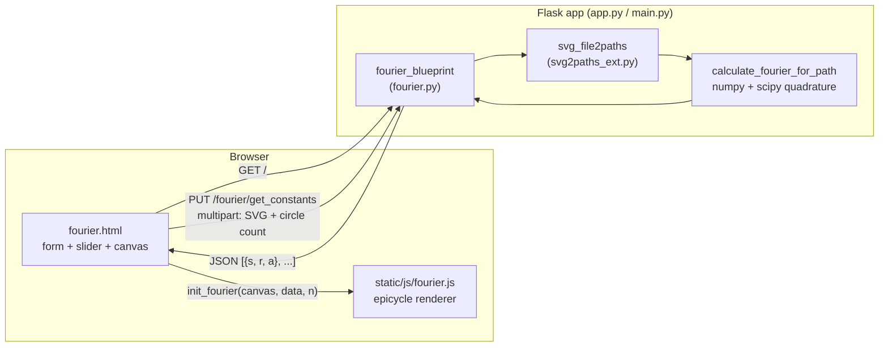
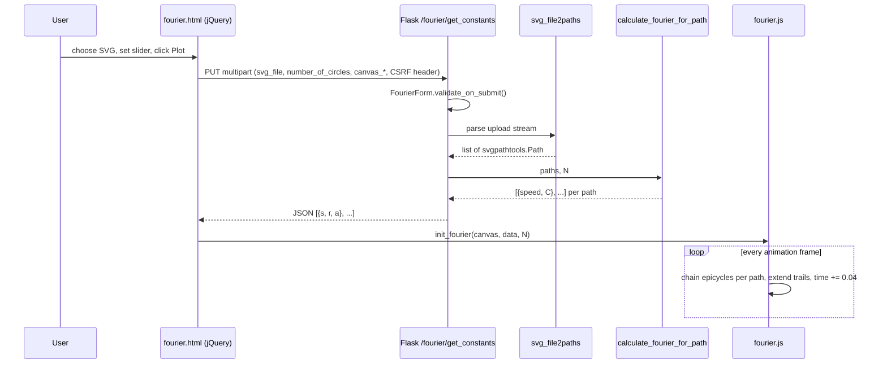

# Architecture

FourierDrawings is a small Flask web app that takes an uploaded **SVG**, splits it into its
individual paths, computes a **complex Fourier series** for each path on the server, and
animates the result in the browser as chains of rotating vectors ("epicycles") that redraw
every path of the image at the same time.

## Repository layout

| Path | Role |
| --- | --- |
| `app.py` | Flask application factory + dev-server entry point (port **8002**). |
| `main.py` | Near-identical copy of `app.py`; only difference is the dev port (**8000**). |
| `fourier.py` | Flask blueprint: routes, upload form, SVG → Fourier coefficient computation. |
| `svg2paths_ext.py` | Variant of `svgpathtools.svg2paths` that accepts a file-like object (the upload stream) instead of a filesystem path. |
| `templates/base.html` | Base Jinja template extending Flask-Bootstrap's `bootstrap/base.html`; adds `main.css` (and an AdSense script). |
| `templates/fourier.html` | The single UI page: upload form, circle-count slider, canvas, and the jQuery AJAX glue. |
| `static/js/fourier.js` | Canvas renderer: builds epicycles from coefficients and animates them with `requestAnimationFrame`. |
| `static/css/main.css` | Styling for the slider / labels. |
| `examples/` | Source raster images, `kiwi.svg`, and a demo GIF (`SOURCES.txt` lists attribution). |
| `examples_svg/` | Ready-made SVG inputs to try in the app. |
| `outputs/` | Screenshots of rendered results (used by `README.md`). |
| `requirements.txt` | Python dependencies (Flask, Flask-WTF, Flask-Bootstrap, flask-appconfig, numpy, scipy, svgpathtools, gunicorn, …). |
| `__pycache__/` | Committed CPython 3.8 bytecode (not source; can be ignored). |

## High-level design



The server is **stateless**: nothing is written to disk or kept between requests. All heavy
math is done server-side once per upload; the browser only evaluates rotating vectors per frame.

## Components

### Application bootstrap — [app.py](app.py)

- [`create_app()`](app.py#L10-L24) creates the `Flask` instance, applies `flask_appconfig.AppConfig`,
  initialises `Flask-Bootstrap`, sets a hard-coded `SECRET_KEY` (needed for Flask-WTF CSRF),
  and registers `fourier_blueprint`.
- A module-level `app = create_app()` makes it usable by a WSGI server (e.g. `gunicorn app:app`).
- When run directly, it starts the Werkzeug dev server with `debug=True` and passes every file
  under `templates/` and `static/` as `extra_files` so the reloader restarts on front-end edits.

### Blueprint & form — [fourier.py](fourier.py)

- [`FourierForm`](fourier.py#L20-L28) (Flask-WTF): `svg_file` (required, `.svg` only),
  `canvas_width`, `canvas_height`, `number_of_circles`, `submit`.
- Routes:

  | Method | Path | Handler | Purpose |
  | --- | --- | --- | --- |
  | `GET` | `/` | [`fourier_index`](fourier.py#L31-L34) | Render `fourier.html` with an empty form (and CSRF token). |
  | `PUT`, `POST` | `/fourier/get_constants` | [`get_fourier_constants_post`](fourier.py#L37-L55) | Validate the upload, compute coefficients, return JSON. On validation failure returns `{"data": form.errors}`. |

### SVG parsing — [svg2paths_ext.py](svg2paths_ext.py)

[`svg_file2paths()`](svg2paths_ext.py#L12-L86) parses the uploaded stream with
`xml.dom.minidom`, collects `d` strings from `<path>` elements (plus `<polyline>`, `<polygon>`
and `<line>` elements), and converts each to an `svgpathtools.Path` via `parse_path`. Each
resulting `Path` is a parametric curve `z(t)` for `t ∈ [0, 1]`, with points represented as
complex numbers `x + iy`.

### Fourier computation — [fourier.py](fourier.py#L74-L147)

1. **Global bounding box.** [`calculate_fourier_for_path`](fourier.py#L99-L147) computes the
   bbox spanning all paths, then sets the working canvas size to *one tenth of that extent*
   (the `canvas_width/height` sent by the client are overwritten here).
2. **Per-path normalisation.** Each path is passed to [`scale_svg`](fourier.py#L89-L96), which
   translates it so its own bbox corner sits at `(20, 20)` and scales it uniformly so its size
   relative to the whole drawing is preserved.
3. **Coefficients.** For each path and each frequency `n`:

   ```
   c_n = ∫₀¹ z(t) · e^(−2πi·n·t) dt
   ```

   evaluated with [`complex_integrate`](fourier.py#L84-L86) → `scipy.integrate.fixed_quad`
   (500-point Gaussian quadrature) over a `np.vectorize`d `path.point(t)`.
4. **Positioning.** Because every path was moved to `(20, 20)`, the DC term `c_0` is shifted
   back by the path's relative offset inside the global bbox (plus a constant `+1500i`
   vertical offset) so that all paths land in the right place on the shared canvas.
5. **Ordering.** For `N = number_of_circles`, each path contributes `2N − 1` coefficients in
   the order `c_0, c_1, c_−1, c_2, c_−2, …, c_(N−1), c_−(N−1)`. Paths are concatenated.
6. **Serialisation.** [`convert_fourier_constant_for_js`](fourier.py#L65-L71) turns each
   complex `c_n` into polar form.

### Front-end page — [templates/fourier.html](templates/fourier.html)

- Renders the form, a range slider (`1…1000`, default `101`), an *auto plot* checkbox, and a
  `<canvas id="fourier_canvas">` sized to 1500×1650 px by `fitToContainer`.
- Intercepts form submit, builds a `FormData` (adding `file`, `canvas_width`, `canvas_height`),
  and sends it as an AJAX **`PUT`** with the CSRF token injected via `$.ajaxSetup` (`X-CSRFToken`).
- On success calls `init_fourier(canvas, data, sliderValue)`.
- If *auto plot* is checked, changing the slider re-submits automatically.

### Renderer — [static/js/fourier.js](static/js/fourier.js)

- [`FourierCircle`](static/js/fourier.js#L19-L46) stores `radius = r / 2`, `speed = s / 20`,
  `initial_angle = a`. Its tip at time `T` is
  `at + radius · e^{i(a + 2π · T · speed)}`.
- [`init_fourier`](static/js/fourier.js#L55-L83) clears the canvas, flips the Y axis once
  (`context.transform(1, 0, 0, -1, 0, height)`), cancels any running animation, derives
  `nr_of_paths = constants.length / (2N − 1)`, builds one `FourierCircle` per coefficient,
  and starts the loop.
- [`draw`](static/js/fourier.js#L132-L183) runs every animation frame. For each path `j` it
  takes that path's slice of circles (offset `j · (2N − 1)`), chains the vectors tip-to-tail
  starting from a fixed `center (150, 150)`, draws the arms, appends the final tip to that
  path's trail `wave[j]`, and draws the trail with fading alpha (capped at 500 points).
  `time` advances by `0.04` per frame, so a speed-1 vector completes one revolution in
  500 frames, matching the trail length (one full period of the drawing).

## Request / render sequence



## Data contract

`PUT /fourier/get_constants` → `200 application/json`

```jsonc
[
  {"s": 0,  "r": 812.4, "a": 1.21},   // path 0, c_0 (position)
  {"s": 1,  "r": 54.2,  "a": -0.33},  // path 0, c_1
  {"s": -1, "r": 12.9,  "a": 2.80},   // path 0, c_-1
  "... 2N-1 entries per path, paths concatenated ..."
]
```

| Field | Meaning |
| --- | --- |
| `s` | Integer frequency `n` (revolutions per period; sign = direction). |
| `r` | `|c_n|` — vector length (rendered at half size). |
| `a` | `arg(c_n)` — initial phase in radians. |

The client must know `N` (it reuses the slider value) to split the flat array back into paths.

## Running

```bash
pip install -r requirements.txt
python app.py            # http://localhost:8002  (main.py → :8000)
# or
gunicorn app:app
```

Bytecode in `__pycache__` indicates development on Python 3.8. `itsdangerous==2.0.1` is pinned
for compatibility with the older Flask / Flask-WTF stack.

## Known issues & caveats

These are observations from reading the code, useful context before changing it. See
[ISSUES.md](ISSUES.md) for file locations and suggested fixes.

- **Only about half of the requested harmonics are animated.** Each path sends `2N − 1`
  coefficients, but `draw()` only iterates `i = 1 … N−1` within each slice, i.e.
  `c_1, c_−1, …` up to roughly `±N/2`.
- **Trails are not reset between plots.** `wave` is appended to on every `init_fourier` call
  but never cleared, and `time` is never reset, so re-plotting can mix stale trails.
- **Client canvas size is ignored** by the server (overwritten with bbox extent / 10), and the
  `+1500i` offset in `c_0` is tuned to the hard-coded 1650 px canvas height.
- **Polylines / polygons are likely broken** in `svg_file2paths`: it calls
  `svg2paths(points)` (which expects a file) instead of converting the `points` string to a
  path `d` string (e.g. `svgpathtools.polyline2pathd`). In practice, SVGs made of `<path>`
  elements work best. Transforms (`transform=`) and `<circle>/<ellipse>/<rect>` are not handled.
- **CLI entry point is broken.** `python fourier.py file.svg N` calls
  `calculate_fourier_for_path` with the wrong arguments (missing `form`, single path instead of list).
- **Duplicated entry points.** `app.py` and `main.py` differ only by port.
- **Secrets / config in source.** `SECRET_KEY = 'devkey'` and a reCAPTCHA key are hard-coded,
  and `templates/fourier.html` contains commented-out third-party API credentials
  (CloudConvert JWT, ConvertApi secret) that should be revoked and removed.
- **Debug leftovers.** Many `print`/`console.log` calls (including one per animation frame),
  unused imports (`matplotlib`, `svgutils`, `smoothed_path`, `secure_filename`, …), and the
  upload `accept="image/*"` attribute even though only `.svg` passes validation.
- **Performance.** Coefficient computation is `O(paths × N × 500)` point evaluations through
  `np.vectorize` in a single synchronous request; large SVGs with high circle counts can be slow.
